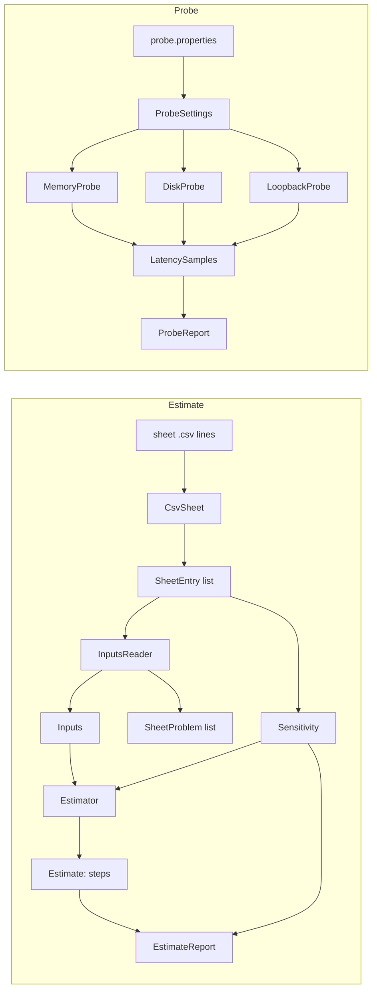

# Architecture

## The three packages

| Package | What it owns |
|---|---|
| `units` | `Dimension`, `Unit` and `Quantity`. A `Quantity` is a number with its unit; it is the only way the program holds or prints a number. |
| `estimate` | `CsvSheet` (reads and writes the sheet), `SheetEntry`, `SheetProblem`, the rules `InputRule`, `StoreField` and `Range`, the records `Inputs` and `Store`, `Estimator`, `Step` and `Estimate`, `Sensitivity` and `SensitivityRow`, `EstimateReport` and the `EstimateCli` entry point. |
| `probe` | `ProbeSettings`, `LatencySamples`, `ProbeOperation`, `MemoryProbe`, `DiskProbe`, `LoopbackProbe`, `ProbeReport` and the `ProbeCli` entry point. |

## The dependency rule

- `estimate` and `probe` depend on `units`.
- `estimate` and `probe` do not depend on each other.
- `units` depends on nothing but the JDK.
- `EstimateCli` and `ProbeCli` are the only classes that print or exit. Everything else returns values.

## The two data flows

## One estimator run

Take `sheets/seatwave-production.csv`.

1. `EstimateCli` checks that the path is a regular file of at most 1,000,000 bytes, and reads it as UTF-8 lines.
2. `CsvSheet.parse` skips comments, checks the header, and turns each line into a `SheetEntry`. It reports every line with the wrong column count, a value that is not a plain decimal, or an empty source.
3. `InputsReader.read` matches each entry to an `InputRule` or a `store.<name>.<field>`. It checks the unit symbol exactly and the range, and reports duplicates and missing inputs. Every problem is collected, so one run lists all the work.
4. With no problem, it builds `Inputs`. The record checks every rule again in its constructor, so no code path can make an `Inputs` with a wrong unit.
5. `Estimator.estimate` computes rate, size, storage, bandwidth, servers, cache and cost, keeping each step with its formula and its `Quantity` result.
6. `Sensitivity.check` doubles each entry in turn (or halves it, when doubling leaves its range), rebuilds the inputs through the same reader, re-estimates, and records the step that moved most.
7. `EstimateReport.render` prints the inputs as a sheet, the steps, the five-line estimate and the sensitivity rows. `EstimateCli` exits with 0, or with 3 when a row is flagged.

## One probe run

1. `ProbeCli` loads `probe.properties`; `ProbeSettings.from` reports every missing or invalid key. There are no defaults in code.
2. `MemoryProbe.timerStep` times two back-to-back `System.nanoTime` calls: the timer's own step.
3. `MemoryProbe.arrayReads` builds one random cycle through an `int` array (Sattolo's algorithm) and follows it: each read gives the index of the next, so reads cannot overlap. Warm-up batches are discarded. It runs once with a 16 KiB array and once with a 256 MiB array.
4. `DiskProbe.measure` writes a 64 MiB temporary file, forces it, times random 4 KiB reads, then times 4 KiB writes each followed by `FileChannel.force(false)`, and deletes the file.
5. `LoopbackProbe.roundTrips` starts an echo server on the loopback address and an operating-system port, connects with `TCP_NODELAY`, and times one byte out and one byte back. Every socket call has the configured timeout.
6. `ProbeReport.render` prints p50 and p99 for each operation beside the published order of magnitude, and marks any gap above 10 times.

## Decisions and trade-offs

**A `Quantity` type instead of `double`.** A bare number has no unit, so nothing stops bytes being added to bits. `Quantity.plus` and `Quantity.timesAsMany` refuse two different units, even two of one dimension such as bytes and GB; a conversion is always an explicit `to(Unit)`. `toString` always ends with the unit symbol. The cost is a wrapper around every number. The gain is that the invariant of the module, every printed number carries a unit and units never mix, holds by construction.

**`BigDecimal` for every quantity.** Money must not be a double, and using one type for every quantity keeps the arithmetic in one style. Sixteen significant digits are far more than any estimate input has. The cost is longer code for each product; the `product` helper in `Estimator` keeps it short.

**Exact units at the boundary, conversions only inside.** The sheet must write `bytes` where bytes are expected; the reader does not convert `KB`. Converting would be friendlier, but `KB` is ambiguous (1,000 or 1,024), and an estimator that quietly guesses hides exactly the slip Module 3 teaches to catch.

**`write_share` as the input, not `read_share`.** Doubling a read share of 85 percent is impossible, and halving 99.8 percent changes the write rate 250 times, which would flag a correct formula. Doubling a write share is a fair test.

**Sensitivity through the reader.** The check changes a sheet entry and rebuilds the inputs with `InputsReader`, so a doubled value that breaks a rule is caught by the same rules the learner meets. The estimator is passed in as a function, so a test can hand it a deliberately broken formula and see the flag.

**The probe has no JMH.** JMH is the right tool for micro-benchmarks, but it is not on the approved list and the module needs orders of magnitude, not nanosecond precision. The probe warms up, batches the reads that are shorter than the timer's step, and reports p99 beside p50.

## The invariant and where it is enforced

**Every printed number carries a unit, and every result is reproducible from the printed inputs.**

1. `Quantity` is the only number type the report and the probe print, and its `toString` always ends with the unit. Enforced by the type; tested in `QuantityTest` (every unit, 200 seeded amounts) and `EstimateReportTest` (every step line ends with a known unit symbol).
2. Units never mix. `Quantity.plus` and `timesAsMany` throw on two different units; `to` throws across dimensions. The reader rejects any unit but the one each input requires. Tested in `QuantityTest` (bits per second with bytes per second, per day with per second, GB with bytes) and `InputsReaderTest` (bits, KB, requests per day).
3. Reproducible. The estimator uses no clock and no randomness, and the report prints the inputs as a valid sheet. Tested in `EstimateReportTest`: the printed inputs are parsed back and give an equal `Estimate`.

## Limits of the teaching build

- A sheet holds at most 1,000,000 bytes, a constant in `EstimateCli`.
- The month is 30 days for traffic (Module 2) and 730 hours for a machine's bill (Module 1).
- The disk reads measure the page cache more than the device; the report and the module say so.
- The command-line classes are not covered by the unit tests, because they call `System.exit`.

## How to extend it

To add an input, add a value to `InputRule` with its unit and range, and use it in `Estimator`. Every sheet without it is then rejected with "missing input", so nothing forgets it silently. To add a unit, add a value to `Unit` with its dimension and its size in the base unit. To add a probe, add a value to `ProbeOperation` with its published line, write a method that returns `LatencySamples`, and add it to `ProbeCli`.
